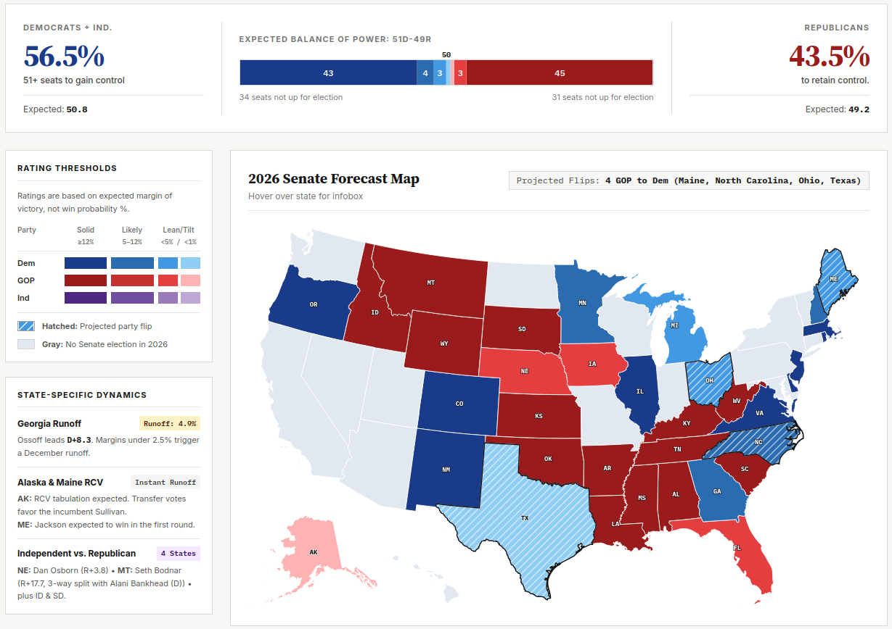

## Overview

This is my prototypical election forecasting project, for the 2026 U.S. Senate elections, for dipping my toes into the realm. It uses a simplified version of DDHQ's model, and incorporates fundamentals, polling, and Cholesky covariance matrices into Monte-Carlo simulations. The project is deployed at:

rgao.github.io/senate2026_forecast

#### Technology

- python/numpy (for data ingestion and simulations)
- HTML/CSS/javascript
- Google Gemini

#### Results

Like most forecasters, this model underestimated Democrats in the 2026 elections, due to a combination of egregious GCB polling error and overvaluing the fundamentals. The 2026 election saw a wave election not seen since Watergate, and Democrats picked up a historic nine Senate seats. The underlying dynamics in the fundamentals had changed (particularly in the deep south), and threw off most election forecasters. Nonetheless, this model did accurate predict the Texas Senate seat flipping, and that the Democrats would gain control of the Senate.